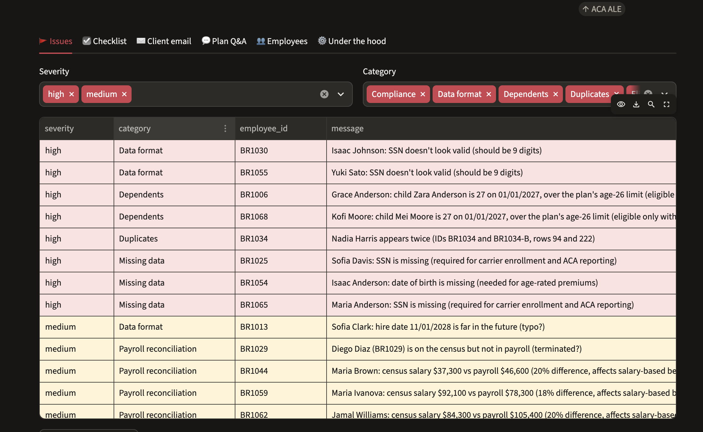
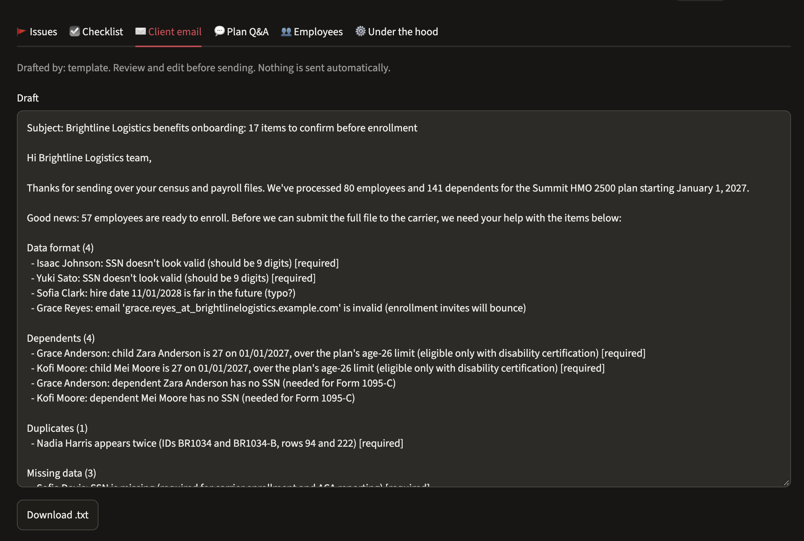
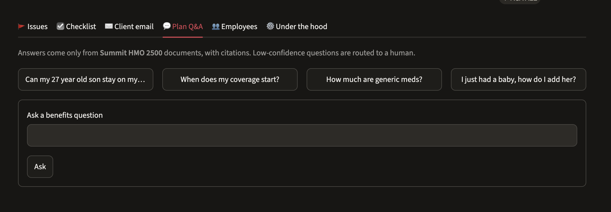

# Benefits Client Onboarding Agent

An AI-assisted pipeline that takes a new benefits client's messy files (**employee census, payroll export, plan document**), checks them for eligibility and compliance problems, and produces everything an onboarding specialist needs: an issues list, a checklist, a draft follow-up email to the client, and a plan Q&A bot for employees.

> Built as a prototype for the *AI & Operations Associate* role: client onboarding, document processing, and AI applied to benefits, payroll, HR and compliance. All data is synthetic.
>
> **100% free to run:** open-source libraries, plus a local open-source LLM via [Ollama](https://ollama.com). No API keys, no accounts, no paid services.

## Screenshots

**Issues found in a client's files**


**AI-drafted follow-up email to the client**


**Employee plan Q&A with citations and human handoff**


---

## What it does

| Step | What happens | AI or code? |
|---|---|---|
| **1. Ingest** | Reads `.xlsx`/`.csv` census and payroll files and plan PDFs | Code |
| **2. Map columns** | Works out that `Hire Dt`, `start_date` and `Date of Hire` all mean `hire_date` | **LLM** (heuristic fallback) |
| **3. Extract plan terms** | Pulls waiting period, hours minimum, dependent age limit and deductibles from the PDF | **LLM** (regex fallback) |
| **4. Run checks** | 20+ rules: missing/invalid SSNs, duplicates, over-age dependents, payroll mismatches, waiting periods, ACA full-time/ALE status | **Code only** |
| **5. Outputs** | Checklist, issues CSV, client email draft | Code + **LLM** for tone |
| **6. Plan Q&A** | Employees ask "can my 27-year-old stay on my plan?" and get a cited answer, or a human handoff | Retrieval + **LLM** |

### Main design decision: the LLM reads, code decides
LLMs are great at the fuzzy part: reading messy headers and prose. They should **not** be the ones deciding whether a dependent is eligible. All eligibility and compliance logic is plain, unit-tested Python, so every flag is reproducible and explainable to a client or auditor. The LLM email step gets a fixed list of issues and is told not to add any.

### Free, local LLM, with fallbacks
The AI steps run on a **local open-source model via Ollama** (default `llama3.2`). It's free, needs no key, and client data never leaves the machine, which matters for payroll and benefits data. Provider order is `auto`: Ollama → (optional, paid) Claude if you add a key → no LLM. Every LLM step also has a deterministic fallback, so the project runs even with no model installed, tests stay free and deterministic, and an LLM outage never blocks onboarding.

---

## Architecture
```
census.xlsx ─┐
payroll.csv ─┼─► ingest ─► LLM column mapping ─► Pydantic models ─┐
plan.pdf ────┘           └► LLM plan-term extraction ─────────────┤
                                                                  ▼
                                                  rules engine (deterministic)
                                                                  │
                    ┌──────────────┬──────────────┬───────────────┤
                    ▼              ▼              ▼               ▼
                checklist     issues CSV    client email     plan Q&A bot
                                                              (RAG + handoff)
        exposed via:  CLI  ·  FastAPI (/onboard, /ask)  ·  Streamlit UI
```

```
app/
  models.py     Pydantic types: Employee, Dependent, PlanRules, Issue
  ingest.py     spreadsheet + PDF parsing
  extract.py    LLM/heuristic column mapping, value normalization, plan-term extraction
  rules.py      eligibility & compliance checks (no LLM)
  outputs.py    checklist, email draft, issues export
  qa.py         retrieval Q&A with citations + confidence-based human handoff
  pipeline.py   run_onboarding(): one call, used by every interface
  llm.py        LLM wrapper: free local Ollama first, optional Claude, graceful fallback
  api.py        FastAPI service
ui/streamlit_app.py
scripts/generate_data.py   synthetic clients with planted errors + ground truth
scripts/evaluate.py        scores the agent against the ground truth
scripts/run_demo.py        CLI report
tests/                     27 unit tests
```

---

## Quick start
```bash
python -m venv .venv && source .venv/bin/activate
pip install -r requirements.txt

python scripts/generate_data.py     # create 3 synthetic clients
python scripts/run_demo.py northwind_bakery
python scripts/evaluate.py
pytest -q

streamlit run ui/streamlit_app.py   # demo UI
uvicorn app.api:app --reload        # API docs at http://localhost:8000/docs
```

### Turn on the free local LLM (optional, recommended)
1. Install Ollama from https://ollama.com (Mac / Windows / Linux)
2. `ollama pull llama3.2`  (~2 GB; `qwen2.5:7b` is more accurate if your laptop has 16 GB RAM)
3. Leave Ollama running and rerun any command above. The sidebar shows **🟢 Ollama · llama3.2 (free, local)**.

To use a different model: `OLLAMA_MODEL=qwen2.5:7b streamlit run ui/streamlit_app.py`

### Free hosting for your demo link
Push the repo to GitHub and deploy `ui/streamlit_app.py` on **Streamlit Community Cloud** (free). The hosted version runs in no-LLM mode with the deterministic fallbacks, which still catches all the planted errors. Use Ollama locally when you record your Loom.

### API example
```bash
curl -F client_name="Northwind Bakery" \
     -F census=@data/synthetic/northwind_bakery/census.xlsx \
     -F payroll=@data/synthetic/northwind_bakery/payroll.csv \
     -F plan_pdf=@data/synthetic/northwind_bakery/plan_summary.pdf \
     http://localhost:8000/onboard
```
This lets n8n, Zapier, a Slack bot or an MCP server trigger onboarding when a client emails their files.

---

## Synthetic data
Three fake clients, each with its own "dialect", because no two clients send files the same way:

| Client | Employees | Format | Quirks |
|---|---|---|---|
| Northwind Bakery | 25 | xlsx | `Emp ID`, `Hrs/Wk`, MM/DD/YYYY, codes `EE/SP/CH` |
| Brightline Logistics | 80 | csv | `fname`, `base_pay` as `"$52,000.00"`, ISO dates |
| Cedar Health Partners | 200 | xlsx | `Tax ID`, `Comp`, real Excel dates, `Self/Dependent` |

Planted errors: missing and truncated SSNs, missing DOBs, 27–29-year-old "children", duplicate rows with different IDs, hire dates in 2028, broken emails, salary mismatches against payroll, employees missing from payroll, and payroll employees missing from the census. Every planted error is recorded in `ground_truth.json`. SSNs use the 9xx range, which is never issued.

## Evaluation (`python scripts/evaluate.py`, no LLM)
| Metric | Result |
|---|---|
| Column mapping accuracy | 30/30 (100%) |
| Planted errors caught | 58/58 (100% recall) |
| False positives on planted error types | 0 (100% precision) |
| Plan Q&A: right section cited, or correct handoff on off-topic questions | 36/36 (100%) |

**Caveat:** these scores are on synthetic data whose error types I designed, so they show the rules work as specified, not how they'd do on real client files. Next steps for a real evaluation: run it on anonymized real censuses, track the errors a specialist catches that the agent missed, and turn each miss into a new rule and test.

Bugs the evals caught during development:
- Employees starting next month were flagged as "future hire date" typos. Now only dates more than 60 days out are flagged, and nearer ones are treated as upcoming hires.
- "Does the plan cover my dog's vet bills?" matched the *Plan Overview* section on generic words like "plan" and "cover" and returned a confident non-answer. Fixed with domain stop-words, so it now hands off to a human.

---

## Data handling
- With Ollama, **no data leaves the machine at all**.
- If a hosted LLM is used, SSNs are **masked to the last 4 digits** before any value is sent (`extract._mask_pii`).
- Only headers plus 3 masked sample rows go to the LLM for column mapping, never the full census.
- The client email never includes SSNs and tells clients not to email them.
- Nothing is sent automatically. A person reviews every email.
- Production would add: encryption at rest, role-based access, an audit log of every flag and override, and data-retention rules.

## Impact estimate
Manually reviewing a 200-employee census against payroll and plan rules typically takes a specialist **several hours**. The pipeline runs in **under a second** and turns the job into a ~15-minute review of flagged items. These are rough estimates and worth validating against real onboarding times.

## Roadmap
- **Slack approval loop** (`slack_bolt`): post the issues summary with *Approve / Edit* before the client email is sent
- **MCP server**: expose `run_onboarding`, `get_client_status` and `search_plan_docs` as tools so Claude can work with onboarding data directly
- **Gmail trigger** (n8n): auto-start onboarding when a client replies with attachments
- Embedding-based retrieval (pgvector) for larger plan document sets
- Carrier-specific enrollment file export (EDI 834)
